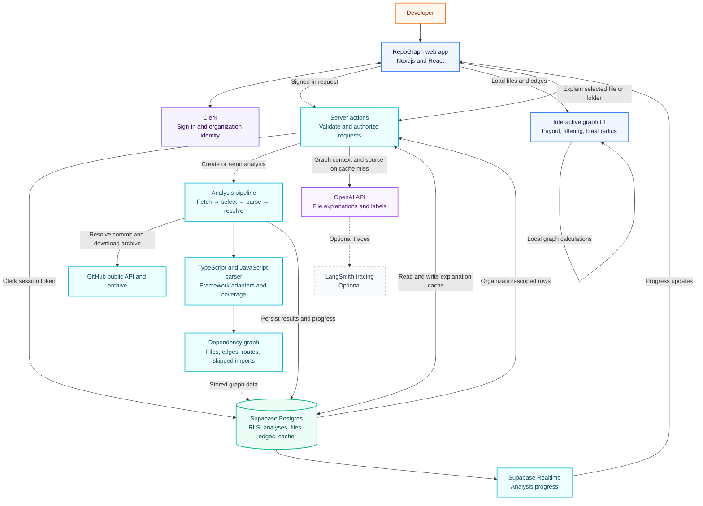

# RepoGraph

<p align="center">
  
  
  
  
  
  
</p>

<p align="center"><strong>Turn an unfamiliar codebase into a map you can explore.</strong></p>

**Understand a codebase by seeing how its files connect.**

RepoGraph turns a public TypeScript or JavaScript GitHub repository into an interactive dependency map. Explore folders and files, follow imports, see what depends on a file, and get an AI explanation grounded in the file and its real neighbours.

> New to a project? RepoGraph helps answer the first questions that are hard to keep in your head: *Where should I start? What does this file do? What could be affected if I change it?*

---

## 🔍 The problem

Joining an unfamiliar project means learning more than its file names. You need to discover how the pieces connect: which modules depend on a shared utility, where a route leads, and what else might be affected by a change.

Reading imports one file at a time makes you build that picture in your head. That gets harder as the project grows, and especially when code has been written over time by several people or AI coding tools.

## 💡 The solution

RepoGraph builds a map from the repository's actual source code:

1. **Fetch** a public repository archive at a specific Git commit.
2. **Parse** TypeScript and JavaScript files, imports, re-exports, dynamic imports, and `require()` calls.
3. **Resolve** each import to a repository file using the project's paths and workspace configuration. Unresolved imports are reported with reasons.
4. **Explore** the resulting graph as folders and files. Select a file to inspect its imports, dependents, fan-in/fan-out, and change blast radius.
5. **Explain** a selected file or folder with AI using parsed source and graph context. AI can explain and label files; it does not invent dependency edges.

The graph is deterministic: its files and connections come from parsing. This keeps the map inspectable and makes skipped or unresolved code visible instead of quietly guessing.

## ✨ What you can do

- Browse a repository as a dependency map, expanding folders into files.
- Select a file to see its dependencies, dependents, exports, and connections.
- Trace incoming and outgoing dependencies and inspect a change's blast radius.
- Review parser coverage, skipped files, and unresolved imports.
- Inspect detected routes where a supported framework adapter can identify them.
- Ask AI to explain a file or folder using real source and neighbouring files; explanations are cached.
- Sign in and keep repository analyses within an organization.
- Follow analysis progress as the repository is fetched, parsed, and stored.

## 🏗️ System architecture

The diagram shows the request path, analysis pipeline, stored data, and how the browser builds the map and requests explanations.



### Architecture notes

- **Clerk** handles sign-in and organization identity. The app uses its session token when accessing Supabase.
- **Supabase** stores organizations, projects, analyses, parsed files, edges, routes, labels, and cached explanations. Row-level security scopes user reads to the organization in the token.
- **The analysis pipeline** resolves a commit first, downloads that exact public archive, then selects and parses files. It writes progress as it moves through the stages.
- **The parser** extracts imports and resolves them against repository files. Framework adapters add framework-specific roles and route information.
- **The browser** renders the stored graph and calculates layout, highlighting, dependency chains, and blast radius from the graph data.
- **OpenAI** generates explanations and labels only. Those requests use real source and parsed graph context; results are cached in Supabase. **LangSmith tracing is optional.**
- The Supabase secret key is used only by the server-side pipeline writer. It must never be exposed to the browser.

## 🧩 Supported input and limits

- Public repositories hosted on `github.com`.
- TypeScript and JavaScript source files.
- Imports, re-exports, dynamic imports, and `require()` calls.
- Framework conventions through parser adapters, including Next.js, React, Express, NestJS, and Docusaurus.
- Repository archives up to **100 MB**.

Private repositories and languages other than TypeScript and JavaScript are not supported. Some imports can remain unresolved when their path is computed at runtime or cannot be mapped to a file; RepoGraph reports these cases in coverage.

## 🚀 Run locally

### Requirements

- Node.js 20 or newer
- pnpm 9.15.9 (the version pinned by this project)
- A Clerk application
- A Supabase project with the RepoGraph schema and row-level security policies
- An OpenAI API key for AI explanations and labels

> **Database setup:** this repository does not include Supabase SQL migrations. `lib/supabase/database.types.ts` describes the expected TypeScript database shape, but it does not create tables or policies. Configure the matching schema, Clerk JWT integration, and organization-scoped RLS policies in your Supabase project before running the full app.

### 1. Install dependencies

```bash
pnpm install
```

### 2. Configure environment variables

Create `.env.local` in the project root. Keep this file private; `.env*` files are ignored by Git.

```dotenv
# Clerk
NEXT_PUBLIC_CLERK_PUBLISHABLE_KEY=
CLERK_SECRET_KEY=
NEXT_PUBLIC_CLERK_SIGN_IN_URL=/sign-in
NEXT_PUBLIC_CLERK_SIGN_UP_URL=/sign-up
NEXT_PUBLIC_CLERK_SIGN_IN_FALLBACK_REDIRECT_URL=/dashboard
NEXT_PUBLIC_CLERK_SIGN_UP_FALLBACK_REDIRECT_URL=/start

# Supabase
NEXT_PUBLIC_SUPABASE_URL=
NEXT_PUBLIC_SUPABASE_PUBLISHABLE_KEY=
SUPABASE_SECRET_KEY=

# OpenAI (needed when an explanation or model label is generated)
OPENAI_API_KEY=

# Optional LangSmith tracing
LANGSMITH_TRACING=false
LANGSMITH_API_KEY=
LANGSMITH_PROJECT=repograph
```

Set the Clerk values from your Clerk dashboard and the Supabase values from your Supabase project's API settings. In Clerk, configure the `supabase` session token template for Supabase and include the organization name claim used by the dashboard (`org_name`). Set up organization support and the sign-in methods enabled for your Clerk application.

`OPENAI_API_KEY` is used on demand, not required for the server to start. Without it, parsing and browsing stored graphs can still work, but requests that need a new AI answer or label will fail. LangSmith variables are optional; tracing is active only when `LANGSMITH_TRACING=true` and an API key is set.

### 3. Start the development server

```bash
pnpm dev
```

Open [http://localhost:3000](http://localhost:3000), sign in, create or select an organization, and submit a public GitHub repository URL.

### 4. Build and run for production

```bash
pnpm build
pnpm start
```

## 🧪 Run the parser by itself

The parser can run locally without Clerk, Supabase, OpenAI, or the web app. This is useful for inspecting what the parser finds in a local TypeScript or JavaScript project.

```bash
pnpm dlx tsx scripts/parse.ts ./path/to/repository
```

Write the complete parse result to JSON:

```bash
pnpm dlx tsx scripts/parse.ts ./path/to/repository --out result.json
```

Validate a saved result:

```bash
pnpm dlx tsx scripts/parse.ts --read result.json
```

Use `--all` to print every unresolved import instead of a short sample per reason.

## 🗂️ Project layout

```text
app/                 Pages, layouts, and server actions
components/          Workspace, map, and landing page UI
lib/parser/          File walking, syntax parsing, import resolution, adapters
lib/graph/           Graph views, folding, highlighting, and reach calculations
lib/pipeline/        GitHub fetch, analysis stages, and persistence
lib/analysis/        Loading graph data and building explanation context
lib/ai/              AI prompts, tasks, cache keys, and tracing
lib/supabase/        Supabase clients and generated database types
docs/                Product notes and implementation specifications
scripts/             Standalone parser and analysis utilities
```

## 🛠️ Useful commands

| Command | Purpose |
| --- | --- |
| `pnpm dev` | Start the local development server |
| `pnpm build` | Build the production app |
| `pnpm start` | Serve the production build |
| `pnpm lint` | Run ESLint |
| `pnpm dlx tsx scripts/parse.ts <directory>` | Parse a local repository and print a summary |

## 🔐 Security and privacy

- Repository analysis currently accepts **public GitHub repositories** and does not ask for a GitHub token.
- Keep `.env.local` and all secret keys out of commits. Only `NEXT_PUBLIC_` values are intended for the browser.
- The Supabase secret key bypasses row-level security and must stay on the server. The pipeline writes explicit organization IDs; normal user reads use the signed-in Clerk token and RLS.
- AI explanations may send the selected file's source and relevant graph context to OpenAI when the answer is not already cached.

## 📄 License

No license file is currently included. Until one is added, the project is not offered under an open-source license.
